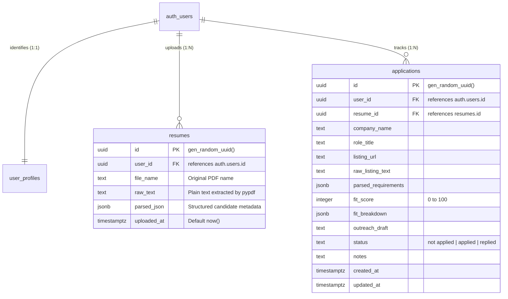

# InternAgent - Project State & Architecture Document

## 1. Project Overview
**InternAgent** is an AI-powered assistant engineered to streamline and accelerate the internship hunting process for students and early-career software engineers.

### Core User Workflow
1. **One-Time Resume Setup**: Candidate uploads their resume in PDF format. The backend extracts text with `pypdf`, parses it into structured candidate metadata via Google Gemini AI (`name`, `contact`, `summary`, `skills`, `experience`, `education`, `projects`), and stores it in Supabase under `public.resumes` with Row Level Security (RLS).
2. **Interactive Verification Card**: The candidate dashboard renders the parsed resume (skills as tags, experience as a vertical timeline, education, and projects) for review and confirmation.
3. **On-Demand Listing Analysis** *(Step 3)*: The user pastes an internship description (text or URL). The AI extracts required competencies and responsibilities.
4. **Fit Scoring & Gap Breakdown** *(Step 3)*: The AI cross-evaluates candidate credentials against the target role, computing a quantitative fit score ($0-100$) and qualitative gap analysis.
5. **Tailored Outreach Generation** *(Step 4)*: Crafts a personalized cold email referencing specific overlaps between the resume and the role.
6. **Application Tracker Dashboard** *(Step 5)*: Tracks all opportunities with status (`not applied`, `applied`, `replied`).

---

## 2. Current Implementation Status

### ✅ Step 1: Project Skeleton
- [x] Initialized dedicated Git repository `internagent` under `tirthm2538-beep/internagent`.
- [x] FastAPI backend with CORS, `/health` endpoint, and virtual environment dependencies (`fastapi`, `uvicorn`, `python-dotenv`, `google-generativeai`, `python-multipart`, `pypdf`, `supabase`).
- [x] Next.js 16 + Tailwind CSS + TypeScript frontend starter.
- [x] Documented planned architecture in `PROJECT_STATE.md` and `README.md`.

### ✅ Step 2: Supabase Auth & Resume Parsing Engine (Complete)
- [x] **Supabase Database Schema (`schema.sql`)**:
  - `public.resumes` table (`id`, `user_id`, `file_name`, `raw_text`, `parsed_json`, `uploaded_at`).
  - Row Level Security (RLS) active: `auth.uid() = user_id` for `SELECT`, `INSERT`, `UPDATE`, `DELETE`.
  - Preview schema for `public.applications` included for future milestones.
- [x] **Supabase Authentication Flow**:
  - Reused auth pattern from `bizbot-saas` with Supabase Auth (`@supabase/supabase-js`).
  - `/signup`: Candidate registration (name, email, password, confirm password).
  - `/login`: Candidate authentication with session validation and redirect.
- [x] **Backend Resume Upload Endpoint (`POST /api/resume/upload`)**:
  - Multi-part file upload validation (`.pdf`).
  - Text extraction powered by `pypdf` (`PdfReader`).
  - Structured entity extraction using Google Gemini (`gemini-3.5-flash` / `gemini-3.8-flash` fallback chain with REST transport).
  - JSON schema: `name`, `contact`, `summary`, `skills` (list), `experience` (list of `{role, company, duration, description}`), `education`, `projects`.
  - Integration with Supabase client to persist records to `public.resumes`.
- [x] **Frontend Candidate Dashboard (`/dashboard`)**:
  - Protected route verifying active Supabase session.
  - Resume upload interface supporting PDF drag-and-drop and file picking.
  - Interactive multi-stage upload progress indicator.
  - **Parsed Resume Profile Card**:
    - Candidate name, summary, and contact chips (email, phone, location, LinkedIn, GitHub, portfolio).
    - **Skills Cloud**: Categorized tag chips with total count indicator.
    - **Experience Timeline**: Vertical timeline connecting nodes with company, role, duration, and bullet points.
    - **Education & Projects**: Institution cards, GPA badges, project descriptions, and tech stacks.
    - Action controls to re-upload or proceed to listing matching.
- [x] **End-to-End Verification**:
  - Created [`scripts/test_resume_flow.py`](file:///c:/Users/Dell-5470/Desktop/Tirth%20work/InternAgent/scripts/test_resume_flow.py) generating `sample_resume.pdf` with real candidate credentials.
  - Tested `pypdf` text extraction (2,093 characters extracted).
  - Tested Gemini AI structured parsing (extracted 19 skills, 2 experience roles, UC Berkeley BS CS degree, 2 projects).

---

## 3. Database Schema Design (Supabase / PostgreSQL)

---

## 4. API Endpoints Reference

| Method | Endpoint | Description | Auth Required |
| :--- | :--- | :--- | :--- |
| `GET` | `/health` | Health check, Gemini status, and Supabase connection | No |
| `POST` | `/api/resume/upload` | Uploads PDF resume, extracts with `pypdf`, parses with Gemini, saves to Supabase | Yes (`Bearer <token>` / `user_id`) |
| `GET` | `/api/resume/latest` | Retrieves candidate's most recent parsed resume | Yes |
| `POST` | `/api/analyze` *(Step 3)* | Ingests job posting text/URL, matches against resume, scores fit (0-100) | Yes |
| `GET` | `/api/applications` *(Step 4)* | Lists tracked applications | Yes |
| `PATCH` | `/api/applications/{id}/status` *(Step 4)* | Updates application status | Yes |

---

## 5. Next Steps (Step 3: Job Listing Extraction & AI Fit Analyzer)
1. **Job Description Input UI**: Text area or URL input component in dashboard.
2. **Backend Listing Extractor**: Scraping / text parsing of job qualifications and requirements.
3. **Dual-Prompt Gemini Scoring Engine**:
   - Compare candidate skills vs role requirements.
   - Calculate objective fit score ($0-100$).
   - Identify overlapping skills, transferable strengths, and missing prerequisites.
4. **Outreach Email Composer**: Draft context-aware cold message tailored to the role.
