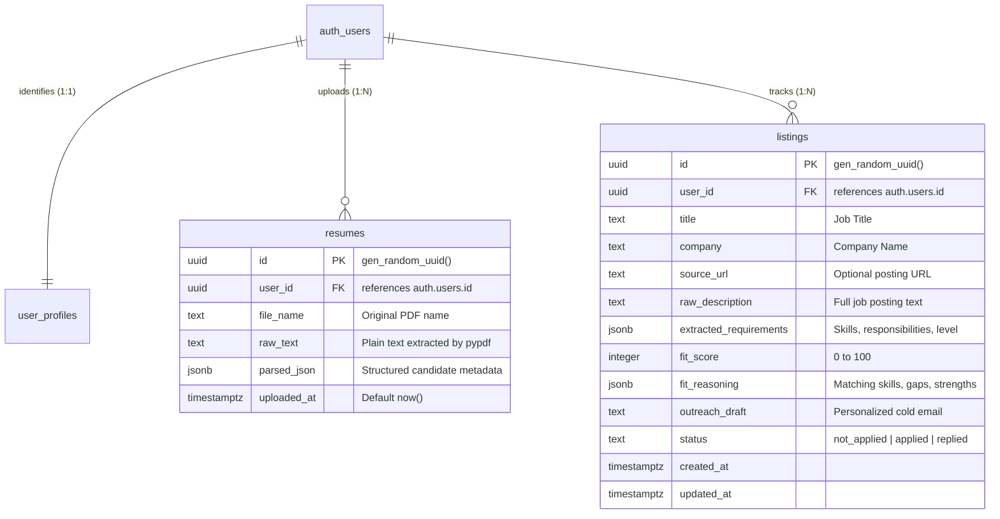

# InternAgent - Project State & Architecture Document

## 1. Project Overview
**InternAgent** is an AI-powered assistant engineered to streamline and accelerate the internship hunting process for students and early-career software engineers.

### Core User Workflow
1. **One-Time Resume Setup**: Candidate uploads their resume in PDF format. The backend extracts text with `pypdf`, parses it into structured candidate metadata via Google Gemini AI (`name`, `contact`, `summary`, `skills`, `experience`, `education`, `projects`), and stores it in Supabase under `public.resumes` with Row Level Security (RLS).
2. **Interactive Verification Card**: The candidate dashboard renders the parsed resume (skills as tags, experience as a vertical timeline, education, and projects) for review and confirmation.
3. **On-Demand Listing Analysis**: The candidate pastes an internship description (text or URL). The AI extracts required competencies and responsibilities.
4. **Fit Scoring & Gap Breakdown**: The AI cross-evaluates candidate credentials against the target role, computing an honest, calibrated fit score ($0-100$) alongside matching skills, missing prerequisite gaps, and observed strengths.
5. **Tailored Outreach Generation**: The agent crafts an authentic, concise cold outreach email referencing 2-3 specific overlaps between the candidate's actual projects and the company's technical stack.
6. **Application Tracker Dashboard**: Unified dashboard tracking all analyzed opportunities with live status toggles (`not_applied`, `applied`, `replied`).

---

## 2. Current Implementation Status

### ✅ Step 1: Project Skeleton
- [x] Initialized dedicated Git repository `internagent` under `tirthm2538-beep/internagent`.
- [x] FastAPI backend with CORS, `/health` endpoint, and virtual environment dependencies (`fastapi`, `uvicorn`, `python-dotenv`, `google-generativeai`, `python-multipart`, `pypdf`, `supabase`, `beautifulsoup4`).
- [x] Next.js 16 + Tailwind CSS + TypeScript frontend starter.
- [x] Documented planned architecture in `PROJECT_STATE.md` and `README.md`.

### ✅ Step 2: Supabase Auth & Resume Parsing Engine
- [x] Supabase Database Schema ([`schema.sql`](file:///c:/Users/Dell-5470/Desktop/Tirth%20work/InternAgent/schema.sql)) with `public.resumes` and RLS (`auth.uid() = user_id`).
- [x] Supabase Authentication flow with `/signup` and `/login` pages.
- [x] Backend endpoint `POST /api/resume/upload` using `pypdf` + Gemini fallback models (`gemini-3.5-flash` / `gemini-3.8-flash` over REST transport).
- [x] Candidate profile dashboard with skills badges, experience timeline, and education cards.

### ✅ Step 3: Fit-Scoring & Outreach Engine (Complete)
- [x] **Supabase `listings` Table**:
  - Columns: `id`, `user_id`, `title`, `company`, `source_url`, `raw_description`, `extracted_requirements` (JSON), `fit_score` (0-100), `fit_reasoning` (JSON), `outreach_draft` (text), `status` (`not_applied` / `applied` / `replied`), `created_at`, `updated_at`.
  - Full Row Level Security (RLS) active across all CRUD operations.
- [x] **Backend Fit-Scoring & Outreach Engine (`POST /api/listing/analyze`)**:
  - Ingests pasted text or fetches from web URLs with `BeautifulSoup` cleaning.
  - Automatically loads the candidate's latest parsed resume from Supabase / cache.
  - Generates objective $0-100$ fit scores, direct matching skill overlaps, missing skill gaps, and evidence-based strength bullet points.
  - Drafts concise, authentic cold outreach messages referencing concrete past projects and metrics.
  - Endpoints added:
    - `POST /api/listing/analyze`: Run AI fit scoring & save listing.
    - `GET /api/listings`: Retrieve all analyzed listings for the authenticated user.
    - `GET /api/listing/{id}`: Retrieve single listing detail.
    - `PATCH /api/listing/{id}/status`: Update application tracker status (`not_applied`, `applied`, `replied`).
- [x] **Frontend "New Listing" Page (`/listings/new`)**:
  - Text area & URL fetch switcher.
  - Prominent fit score gauge with color coding (Emerald $\ge 80$, Sky $\ge 65$, Amber $\ge 45$, Rose $< 45$).
  - Matching skills (green tags), gaps/missing skills (rose tags), strengths bullet points, and extracted role responsibilities.
  - Tailored outreach draft card with one-click "Copy Outreach Message" button and visual feedback.
- [x] **Dashboard Application Tracker (`/dashboard`)**:
  - Interactive opportunities list/table with company, role title, fit score badge, date, and status selector.
  - Status filter tabs (`All`, `Not Applied`, `Applied`, `Replied`).
  - Interactive status dropdown (`not_applied` / `applied` / `replied`) updating the database in real-time.
  - "View Details" modal showing full outreach draft, skills breakdown, and copy button.
- [x] **End-to-End Verification Across 3 Real Listings**:
  - Tested in [`scripts/test_listing_analysis.py`](file:///c:/Users/Dell-5470/Desktop/Tirth%20work/InternAgent/scripts/test_listing_analysis.py):
    1. **Vercel Frontend Intern**: **93% Fit Score** (11 matching skills: Next.js, React, TypeScript, GraphQL, Tailwind, Jest; outreach cites DevMetrics & CloudScale Systems).
    2. **Scale AI Backend/AI Intern**: **92% Fit Score** (9 matching skills: Python, FastAPI, Redis, PostgreSQL, Gemini API, Docker, Celery; outreach cites TechNova Labs & TaskFlow AI).
    3. **Tesla Embedded Firmware Intern**: **42% Fit Score** (Honest calibration: identifies lack of Embedded C, FreeRTOS, and CAN bus while highlighting C++ systems fundamentals).
    4. **Status Lifecycle**: Successfully updated status to `applied` and `replied`.

---

## 3. Database Schema Design (Supabase / PostgreSQL)

---

## 4. API Endpoints Reference

| Method | Endpoint | Description | Auth Required |
| :--- | :--- | :--- | :--- |
| `GET` | `/health` | Health check, Gemini status, and Supabase connection | No |
| `POST` | `/api/resume/upload` | Uploads PDF resume, extracts with `pypdf`, parses with Gemini, saves to Supabase | Yes (`Bearer <token>` / `user_id`) |
| `GET` | `/api/resume/latest` | Retrieves candidate's most recent parsed resume | Yes |
| `POST` | `/api/listing/analyze` | Ingests job posting text/URL, matches against resume, scores fit (0-100), drafts outreach, saves to Supabase | Yes |
| `GET` | `/api/listings` | Lists all analyzed opportunities for the user | Yes |
| `GET` | `/api/listing/{id}` | Retrieves single listing details | Yes |
| `PATCH` | `/api/listing/{id}/status` | Updates listing application status (`not_applied`, `applied`, `replied`) | Yes |

---

## 5. Next Steps
1. **Outreach Tone & Format Customizer**: Tone toggle (Recruiter email, LinkedIn cold InMail, casual networking message).
2. **URL Fetch Enhancement**: Support headless browser or reader-mode extraction for JS-heavy job boards (Workday, Greenhouse, Lever).
3. **Analytics & Funnel Metrics**: Application conversion metrics (Total Analyzed $\rightarrow$ Applied $\rightarrow$ Replied response rate).
