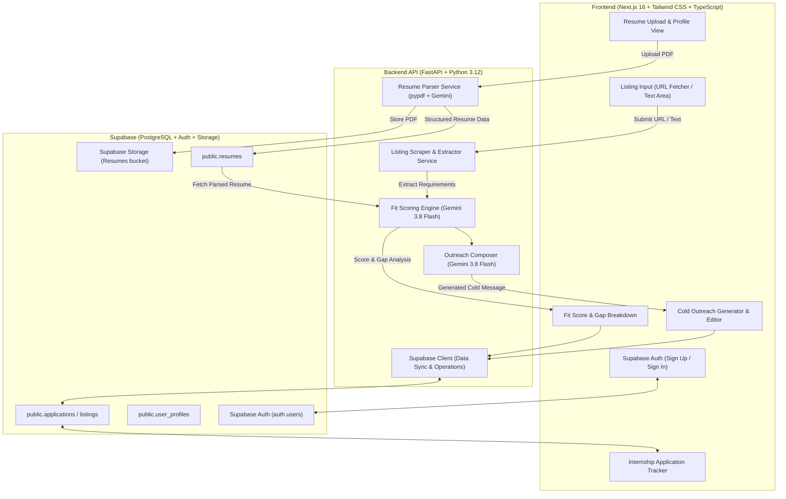
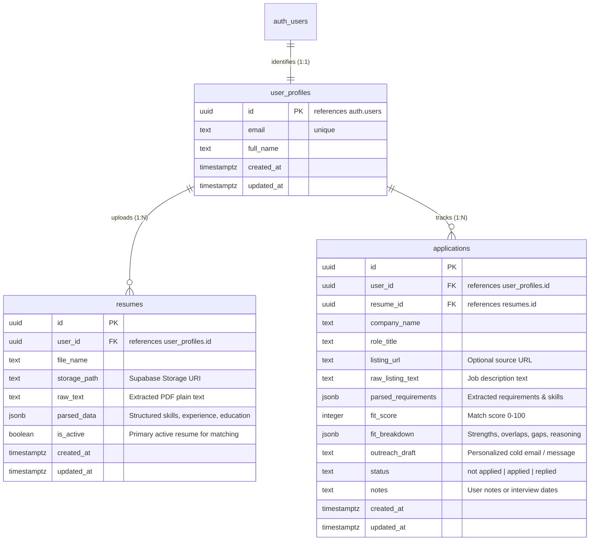

# InternAgent - Project State & Architecture Document

## 1. Project Overview
**InternAgent** is an AI-powered assistant engineered to streamline and supercharge the internship search process for students and job seekers.

### Core User Workflow
1. **One-Time Resume Setup**: The user uploads their resume once (PDF format). The AI parses and stores structured candidate metadata (skills, projects, work experience, education, key achievements).
2. **On-Demand Listing Analysis**: The user pastes a job/internship posting (either raw text or a job posting URL). The AI extracts core job requirements, qualifications, and role responsibilities.
3. **AI Fit Scoring & Gap Analysis**: The AI cross-evaluates candidate credentials against the target role, computing a quantitative fit score ($0-100$) and qualitative insights (direct skill overlaps, transferable skills, missing requirements/gaps, recommendation highlights).
4. **Tailored Outreach Generation**: The agent crafts an authentic, highly personalized cold outreach message / email tailored to recruiters or hiring managers, explicitly referencing relevant accomplishments from the resume that solve the employer's listed challenges.
5. **Application Tracker Dashboard**: A unified dashboard tracks all analyzed listings, displaying company, role, match score, application status (`not applied` / `applied` / `replied`), cold email drafts, notes, and direct links.

---

## 2. Planned System Architecture



---

## 3. Database Schema Design (Supabase / PostgreSQL)

Following the auth and tenancy pattern established in `bizbot-saas`, user identities are linked directly to `auth.users`, with Row Level Security (RLS) guaranteeing strict data isolation per user.



### Table Specifications
1. **`user_profiles`**:
   - Tied 1:1 to `auth.users` via foreign key `id`.
   - Populated automatically via a PostgreSQL trigger (`handle_new_user()`) when a user signs up.
2. **`resumes`**:
   - Stores candidate resume files and structured JSON extracted using `pypdf` and Gemini.
   - `parsed_data` JSON schema:
     ```json
     {
       "candidate_name": "string",
       "contact": { "email": "string", "linkedin": "string", "github": "string" },
       "education": [{ "institution": "string", "degree": "string", "graduation_year": "string", "gpa": "string" }],
       "skills": {
         "technical": ["string"],
         "frameworks_tools": ["string"],
         "soft_skills": ["string"]
       },
       "experience": [{ "company": "string", "role": "string", "duration": "string", "highlights": ["string"] }],
       "projects": [{ "title": "string", "tech_stack": ["string"], "description": "string", "link": "string" }]
     }
     ```
3. **`applications`**:
   - Stores each analyzed opportunity and cold outreach draft.
   - Status transitions: `not applied` $\rightarrow$ `applied` $\rightarrow$ `replied`.
   - `fit_breakdown` JSON schema:
     ```json
     {
       "score": 85,
       "summary": "Strong fit for Frontend / Fullstack role with React & Python experience.",
       "matching_skills": ["React", "FastAPI", "TypeScript", "REST APIs"],
       "missing_skills": ["GraphQL", "AWS Lambda"],
       "strengths": ["Demonstrated production experience in Next.js and API architecture."],
       "growth_areas": ["Prepare answers regarding cloud deployment and serverless patterns."]
     }
     ```

---

## 4. Backend Service Endpoints (FastAPI)

- `GET /health`: Health check endpoint returning API operational status and timestamp.
- `POST /api/resume/upload`: Accepts PDF multipart form upload, extracts text with `pypdf`, extracts structured JSON with Gemini, and saves to database.
- `GET /api/resume/active`: Retrieves current user's active resume and parsed attributes.
- `POST /api/analyze`:
  - Input: `{ "raw_text": "...", "url": "..." }`
  - Action: Parses job listing, compares against active resume, calculates fit score ($0-100$), generates breakdown and cold email.
  - Output: Full analysis and pre-filled application record.
- `GET /api/applications`: Lists user's analyzed applications with sorting/filtering by status and score.
- `PATCH /api/applications/{id}/status`: Updates listing tracker status (`not applied`, `applied`, `replied`).
- `PUT /api/applications/{id}/outreach`: Updates/refines tailored outreach text.

---

## 5. Security & Authentication Model

- **Supabase JWT Verification**: Backend endpoints authenticate requests by inspecting the `Authorization: Bearer <token>` Supabase JWT header.
- **Row Level Security (RLS)**: Enforces that users can only read and mutate their own resumes, profiles, and applications (`auth.uid() = user_id`).
- **Environment Isolation**:
  - API keys (`GEMINI_API_KEY`, `SUPABASE_KEY`) remain securely held on the FastAPI backend.
  - Public keys (`NEXT_PUBLIC_SUPABASE_URL`, `NEXT_PUBLIC_SUPABASE_ANON_KEY`) are exposed only to the Next.js frontend client for standard auth sessions.

---

## 6. Implementation Roadmap
- [x] **Step 1: Project Skeleton & Tooling Setup**
  - [x] Dedicated Git repository initialized for `internagent`.
  - [x] FastAPI backend with CORS, `/health` endpoint, `.env` placeholders, `.gitignore`, and Python virtual environment with dependencies (`fastapi`, `uvicorn`, `python-dotenv`, `google-generativeai`, `python-multipart`, `pypdf`, `supabase`).
  - [x] Next.js frontend starter with Tailwind CSS and TypeScript.
  - [x] Architecture & database specification documented in `PROJECT_STATE.md`.
  - [x] Public GitHub repository created under `tirthm2538-beep/internagent` and initial push committed.
- [ ] **Step 2: Supabase Schema & Auth Integration**
  - Supabase database schema migration script (`schema.sql`).
  - Login / Signup / Session management using Supabase Auth (sharing the pattern from `bizbot-saas`).
- [ ] **Step 3: Resume Parsing Engine**
  - PDF upload handling via FastAPI.
  - Text extraction via `pypdf` + structured extraction via Gemini API.
- [ ] **Step 4: Job Listing Extraction & AI Fit Analyzer**
  - Text and URL job posting ingestion.
  - Dual-prompt Gemini scoring engine (match score + gap analysis).
- [ ] **Step 5: Tailored Outreach Drafting & Application Tracker**
  - Cold email generator with copy-to-clipboard and tone adjustments.
  - Kanban / Table tracker dashboard with status updates (`not applied`, `applied`, `replied`).
